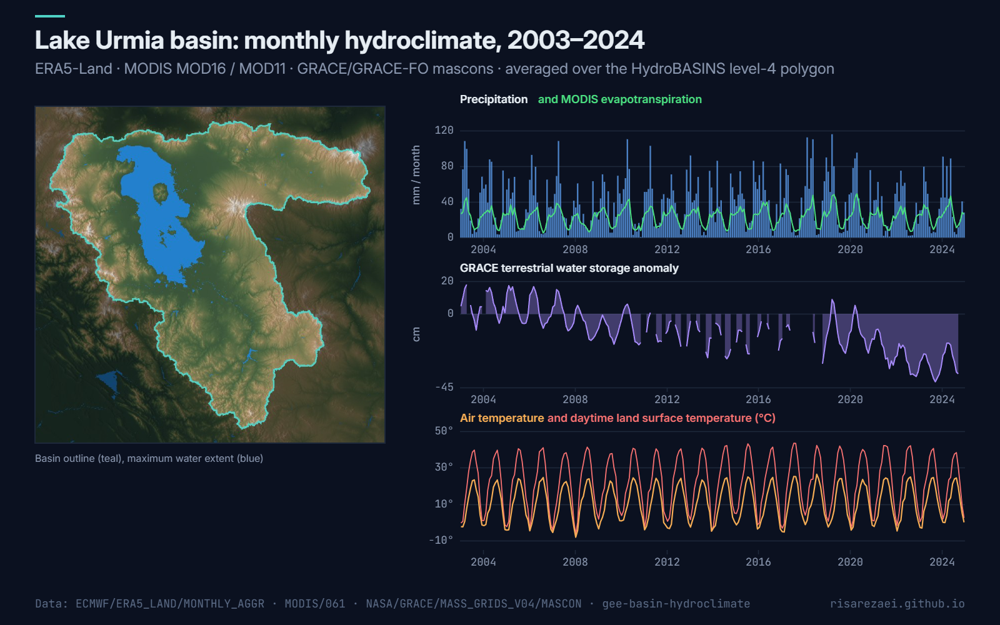

# Basin Hydroclimate Time Series

One script, one tidy table: **monthly precipitation, evaporation, evapotranspiration, air and land-surface temperature, and GRACE terrestrial water storage** averaged over any river basin. It's ready for water-balance analysis, drought studies or hydrological model forcing.

Example output for the Lake Urmia basin (HydroBASINS level 4, 52,199 km²), January 2003 to December 2024.

## Variables

| Column | Variable | Dataset | Resolution |
|---|---|---|---|
| `precip_mm` | Precipitation (mm/month) | ERA5-Land monthly | ~11 km |
| `evap_mm` | Total evaporation (mm/month) | ERA5-Land monthly | ~11 km |
| `et_modis_mm` | Actual evapotranspiration (mm/month) | MODIS MOD16A2GF v061 | 500 m |
| `t2m_c` | 2 m air temperature (°C) | ERA5-Land monthly | ~11 km |
| `lst_day_c` | Daytime land surface temperature (°C) | MODIS MOD11A2 v061 | 1 km |
| `tws_cm` | Terrestrial water storage anomaly (cm) | GRACE/GRACE-FO JPL mascons | 0.5° |

## Quick start

1. Open the [Earth Engine Code Editor](https://code.earthengine.google.com).
2. Paste [`basin_hydroclimate.js`](basin_hydroclimate.js) into a new script.
3. Pick basins with `basinPoints` (`[name, lon, lat]`: the HydroBASINS polygon containing each point), or set `customBasins` to your own FeatureCollection with a `name` property.
4. Press **Run** to see three charts per basin, then export the CSV from **Tasks**.

## Configuration

| Parameter | Default | Description |
|---|---|---|
| `basinPoints` | Lake Urmia | Basins picked by points |
| `hydrobasinsLevel` | `4` | HydroBASINS level (1 = continental, 12 = small catchments) |
| `customBasins` | `null` | Your own polygons instead |
| `start` / `end` | 2003–2024 | Period (GRACE starts in April 2002) |

## Output

`basin_hydroclimate.csv`: one row per basin and month:

`name, month, precip_mm, evap_mm, et_modis_mm, t2m_c, lst_day_c, tws_cm`

Months without data for a variable (for example the GRACE / GRACE-FO gap from mid-2017 to mid-2018) are left empty.

## Notes

- MOD16 ET is an 8-day sum. The script converts it to a monthly total from the mean daily rate, so partial 8-day periods at month edges are handled consistently.
- GRACE mascons are coarse (about 300 km effective resolution). For basins smaller than about 100,000 km², read `tws_cm` as a regional signal.
- ERA5-Land evaporation is reported negative (upward flux); the script flips the sign so that evaporation is positive.

## Data

- ERA5-Land monthly aggregates: [`ECMWF/ERA5_LAND/MONTHLY_AGGR`](https://developers.google.com/earth-engine/datasets/catalog/ECMWF_ERA5_LAND_MONTHLY_AGGR)
- MODIS ET: [`MODIS/061/MOD16A2GF`](https://developers.google.com/earth-engine/datasets/catalog/MODIS_061_MOD16A2GF) · LST: [`MODIS/061/MOD11A2`](https://developers.google.com/earth-engine/datasets/catalog/MODIS_061_MOD11A2)
- GRACE mascons: [`NASA/GRACE/MASS_GRIDS_V04/MASCON`](https://developers.google.com/earth-engine/datasets/catalog/NASA_GRACE_MASS_GRIDS_V04_MASCON)
- HydroBASINS: [`WWF/HydroSHEDS/v1/Basins`](https://developers.google.com/earth-engine/datasets/catalog/WWF_HydroSHEDS_v1_Basins_hybas_4)

## Author

**Parisa Abbasalizadehrezaei** · [risarezaei.github.io](https://risarezaei.github.io)

Released under the [MIT License](LICENSE).
